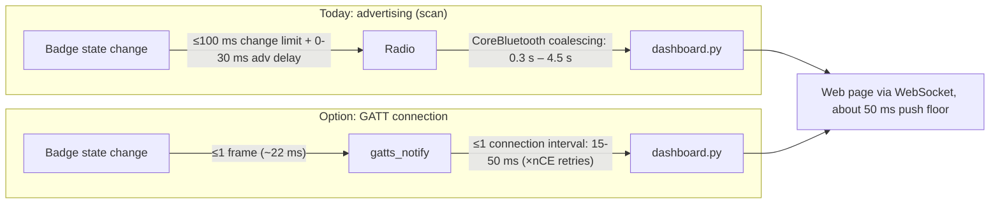

# Concurrent BLE connections on macOS and Windows, and the latency gain from connecting every badge

*Research only. No code or firmware was changed. Repository citations are at commit `18ac35579c4b0d26cfe5abd191894428de905dac` (branch `tbries/leaderboard`).*

## Executive summary

**How many devices?**
- **macOS:** Apple publishes no limit.[^apple-forum] Field reports and vendor testing put the reliable number of BLE devices streaming notifications at about **5–8**.
  - Movella's IMU manual documents **7** sensors for macOS and Windows.[^movella]
  - Above about 8, behaviour depends on the hardware and OS version.
- **Windows:** Microsoft staff describe **up to 7 connections, with 3–4 practical**, and say this is "by design".[^ms-qa] The result depends heavily on the adapter.
  - Intel AX200–AX211 radios are known to be unstable with more than one LE device.[^intel]
  - Expect **3–5 reliable** with the built-in radio.
- **Four plushies** fit within macOS's range and are borderline but plausible on Windows. Fifteen to twenty would need dedicated hardware on either OS (see [Alternatives](#alternatives)).

**What latency gain?** A held GATT connection with notifications should give:
- **median ≈ 20–60 ms**;
- **p99 ≈ 100–300 ms**;
- a worst case set by the connection interval, not by OS scan coalescing.

Today's tuned advertising path measures:
- **median 0.31–0.55 s**;
- **p90 0.9–1.5 s**;
- **max 2–4.5 s** (`tools/adv_latency.py`, 20 ms adverts).

That is roughly **10× better at the median and 10–30× better in the tail**, and the latency is *bounded* rather than random.

**Pairing vs connecting:** pairing or bonding is **not needed** and does **not** reduce steady-state latency. What matters is holding a *connection* and subscribing to notifications. Bonding only speeds up encrypted reconnects. bleak cannot pair on macOS anyway.[^bleak-mac]

**Badge-side limits:**
- **One central per badge.** The stock MicroPython rp2/BTstack build used by the Badger 2350 allows one connection: `MAX_NR_HCI_CONNECTIONS=1`.[^mp-cfg]
- **A connected badge stops advertising.** BTstack suppresses adverts while the peripheral connection slot is full.[^bt-adv]
- **Consequences:**
  - The dashboard and the recorder cannot both be connected to one badge.
  - A connected badge disappears from passive scanners, including the current dashboard.

## 1. Background: the current design and measured baseline

The dashboard (`dashboard.py`) only **scans**. Each badge broadcasts its state and totals in the scan response (`protocol.py`, `STATS_UUID 0xA17E`). The recorder (`recorder.py`) **connects** with `BleakClient` and subscribes to `STREAM_UUID`. It receives about 25 notifications per second (`NOTIFY_MIN_MS=40`), with the state in every sample, which is why it feels near real time.

Measured with `tools/adv_latency.py` (results in the session folder, not the repo):

| Build | Fresh-report latency p50 | p90 | max | Updates heard |
|---|---|---|---|---|
| Original (250 ms adverts, 500 ms refresh) | 1.8–3.6 s | — | up to ~17 s | ~20% |
| 100 ms adverts (Copilot) | 1.2 s | — | — | — |
| 30 ms adverts (Copilot) | 0.61 s | — | — | 76% |
| 20 ms adverts + 250 ms refresh (Copilot) | 0.32 s | 0.63 s | — | — |
| **Current, all 4 badges, with throws** | **0.31–0.55 s** | **0.9–1.5 s** | **2–4.5 s** | 7/7 take-offs heard in the air |

The remaining lag comes mostly from **CoreBluetooth**:
- bleak starts scanning without `CBCentralManagerScanOptionAllowDuplicatesKey`.[^bleak-scan]
- macOS coalesces repeated adverts from the same device and delivers them at an irregular rate that it controls.
- Copilot was consistently heard best and Duckie worst, which suggests RF placement and antenna orientation also matter.

## 2. macOS limits

| Item | Finding | Confidence |
|---|---|---|
| Published connection limit | None. Apple forum engineers say a limit exists, isn't documented, varies by device and OS, and has no API to query it.[^apple-forum] | High |
| Reported practical limit | 3–5 stable (Apple Community/StackExchange[^se]); 7 on macOS according to Movella's manual[^movella]; 20+ reported on iOS[^so-ios]. Classic-Bluetooth peripherals (keyboard, mouse, AirPods) share the same controller. | Medium |
| **Best estimate** | **5–8 reliable**; 8–10+ possible but not guaranteed | Medium |
| Connection interval | The app can't set it. Apple's accessory guidelines require ≥15 ms in multiples of 15 ms (11.25 ms for HID).[^pt-ci][^silabs-apple] The central may reject the peripheral's requests and likely stretches the interval as links are added. | High (floor) / Low (stretching) |
| Pairing | bleak `pair()` raises `NotImplementedError` on macOS. It isn't needed for unauthenticated characteristics.[^bleak-mac] | High |
| Lifecycle gotchas | Use a fresh `BleakClient` per connection (resource leak, bleak #762). Scanning while connections are active is reportedly throttled (anecdotal). | Medium |

## 3. Windows limits

| Item | Finding | Confidence |
|---|---|---|
| Stated limit | Microsoft Q&A: up to 7 connected, "3–4 practical", "by design".[^ms-qa] bleak: "depends on the Bluetooth adapter".[^bleak-client] | Medium |
| Adapter dependency | Intel AX200/201/210/211/411 are unstable with several LE devices; another brand's USB dongle fixes it.[^intel] Only **one** Bluetooth radio is active system-wide, so a dongle must replace the built-in one.[^ms-faq-hw] | High |
| Community data | bleak discussion #574: 3 devices already unreliable on some machines. | Medium |
| **Best estimate** | **3–5 reliable**, soft cap ~7; strongly adapter-dependent | Medium |
| Connection interval | Before Windows 11 there's no app control (about 15–60 ms in practice). Windows 11 adds `RequestPreferredConnectionParameters` (Balanced / PowerOptimized / ThroughputOptimized), with undocumented values.[^ms-ccp] ThroughputOptimized reduces how many connections fit.[^btframework] bleak's WinRT backend doesn't appear to call it. | Medium / Low |
| Pairing | Not needed for GATT since build 15030.[^ms-faq] Watch for "Unreachable" errors from the GATT cache after firmware changes. | High |
| Scanning | The WinRT watcher runs in active mode and raises a `Received` event per PDU, without macOS-style coalescing.[^bleak-winrt] The advert path is probably *already better on Windows* than on macOS, but we haven't benchmarked it. | Medium |

### Vendor cross-check (wearable IMU makers)

| Source | OS | Max sensors documented |
|---|---|---|
| Movella (Xsens) DOT user manual §2.6.1[^movella] | macOS, Windows, Android | **7** |
| Movella DOT | iOS, Linux, Raspberry Pi | 11 |
| MbientLab USB dongle[^mbient] | Windows/Linux via its dongle (macOS not supported) | ~4 per dongle |
| Nordic SoftDevice (nRF52840 dongle)[^nordic-20] | Any OS, via its own driver | 20 (hard link-layer cap) |

Movella's manual: *"BLE performance cannot be guaranteed if the connection limit is reached… reduce the sensor connection number or the transmission payload."* A peer-reviewed system with 10–12 body IMUs abandoned BLE connections for a custom 2.4 GHz protocol for this reason.[^gonzalez]

## 4. Badge-side constraints (MicroPython rp2 / BTstack / CYW43439)

1. **One connection per badge.**
   - `extmod/btstack/btstack_config_common.h:17-18` sets `MAX_NR_GATT_CLIENTS 1` and `MAX_NR_HCI_CONNECTIONS 1`.[^mp-cfg]
   - The rp2 port's `btstack_config.h` doesn't override them, and neither does `pimoroni/badger2350` (`board/mpconfigboard.cmake`).
   - BTstack also defaults `le_max_number_peripheral_connections = 1` (`src/hci.c:5788`), and MicroPython never calls `gap_set_max_number_peripheral_connections`.
   - Raising the limit means a **custom firmware build**. Raspberry Pi says the cap is a build choice, not a chip limit (pico-feedback#313).
2. **A connected badge stops advertising.**
   - `hci_update_advertisements_enabled_for_current_roles()` (`src/hci.c:1789-1807`) sets `enabled = num_slave_connections < le_max_number_peripheral_connections`. With one central connected, this is false.
   - Our 250 ms `gap_advertise()` refresh therefore *succeeds silently but sends nothing*.
   - Advertising resumes automatically on disconnect (`src/hci.c:4601-4606`).[^bt-adv]
3. **The peripheral can't choose the connection interval.** MicroPython exposes no connection-parameter request; it can only observe the result via `_IRQ_CONNECTION_UPDATE`.
4. **Throughput per link:** about one ACL packet per connection event on CYW43439 (pico-sdk#1342). That's ample for a few state notifications per second, and the recorder's 25/s stream already works.
5. **Known bug:** notifications may stop after a reconnect (micropython#12801). Re-subscribe on every connect.
6. **Firmware is already partly ready.** `badge/apps/airtime/__init__.py` loops `gatts_notify` over a `connected` set. However, the stream carries per-sample state, **not the cumulative totals** that the dashboard charts. Those are only in the advert today.
7. **Power:** not measured. A held connection at 15–30 ms is probably comparable to or more expensive than advertising every 20 ms. Measure it before relying on battery life.

## 5. Pairing vs connecting

| Term | What it is | Effect on latency |
|---|---|---|
| Connect | A link layer connection with a fixed connection interval; the peripheral can send a notification at every connection event | **This is what removes the lag** |
| Pair | Exchange keys and encrypt the link | None in steady state; adds round trips at connect time |
| Bond | Store the keys for later | Faster *encrypted* reconnects only |

Sources: Nordic DevZone 11939, Bluetooth SIG blog, Punch Through.[^pt-ci] Notifications aren't delayed by slave latency when the peripheral has data.

## 6. Latency comparison

### Expected latency budget for the connection path

| Stage | Typical |
|---|---|
| Badge detects the state change (frame loop at ~45 Hz) | ~0–22 ms |
| Wait for the next connection event | 0–1 interval (15–30 ms on macOS; 15–60 ms on Windows) |
| Retransmissions under Wi-Fi interference (nCE 2–3)[^spoerk] | +1–2 intervals |
| OS stack, bleak and asyncio dispatch | a few ms (not benchmarked) |
| Server push floor (`PUSH_MIN_S=0.05`) and WebSocket | ≤50 ms |

The **interval stretches with link count.** A central must fit N connection events into each interval. The Nordic formula is roughly `N × t_event ≤ interval`, with `t_event` ≈ 2.5 ms.[^nordic-sched] Apple and Intel controllers don't publish theirs, so this is an analogy:

| Badges connected | Likely interval | Median notification latency | p99 (noisy RF) |
|---|---|---|---|
| 4 | 15–30 ms | ~20–40 ms | ~60–120 ms |
| 8 | 20–45 ms | ~25–50 ms | ~80–200 ms |
| 20 | 50–75 ms (and beyond the OS's reliable range) | ~50–100 ms | ~150–400 ms |

### Scan vs connect, side by side (4 badges)

| Metric | Advert scan (measured) | GATT notifications (expected) | Gain |
|---|---|---|---|
| Median | 0.31–0.55 s | ~0.02–0.06 s | ~10× |
| p90/p99 | 0.9–1.5 s (p90) | ~0.06–0.12 s (p99) | ~10–20× |
| Worst case | 2–4.5 s | ~0.2–0.3 s, unless the link drops | ~15–20× |
| Share of updates delivered | most changes; some coalesced | every notification (acknowledged at the link layer) | — |
| Out-of-range return | heard within seconds with no extra work | **cold reconnect 2–5 s** (scan, connect, discovery, subscribe; bleak #1128 measured ~2.3 s for connect alone);[^bleak-1128] faster with a service cache | Worse |

The end-to-end figure on the page includes about 50 ms for the server push and WebSocket. So expect about **70–110 ms median** "throw to line moves" with connections, against about 0.35–0.6 s today.

## 7. Trade-offs and risks

- **Recorder conflict:** each badge accepts one central. While the dashboard is connected, `recorder.py` can't connect, and the reverse. The dashboard would need to release a badge on demand.
- **Invisible while connected:** connected badges stop advertising, so the scan path can't serve as a live backup for the same badge. The dashboard must treat "connected" and "advertising" as exclusive states.
- **Totals over GATT:** the dashboard needs `air_ms` and throw counts, which only the advert carries today. This needs a new characteristic or a field in the stream. Change `protocol.py` and `badger/home` in step.
- **Scale:** 4 badges is fine on macOS and borderline on Windows. More than 8 isn't reliable on either built-in radio.
- **Reconnect storms:** plushies thrown out of range drop their links, and reconnecting takes seconds. Connect to badges one at a time, with backoff, to avoid controller thrash.
- **Battery:** unmeasured; measure before the event.
- **macOS quirks:** use a fresh client per connection, and scanning may be throttled while connections are active.

## 8. Alternatives {#alternatives}

| Approach | Devices | Latency | Effort | macOS/Windows |
|---|---|---|---|---|
| Current scan (20 ms adverts) | unlimited | 0.3–0.6 s median, seconds tail | done | yes |
| GATT connections on the built-in radio | ~4–8 (macOS), ~3–5 (Windows) | ~20–60 ms | medium (dashboard plus protocol) | yes |
| **USB "base-station" badge or MCU** scanning with duplicates off and forwarding over serial | unlimited | likely ≤100 ms (not benchmarked) | medium (firmware plus serial reader) | yes; bypasses the OS stack |
| Linux/BlueZ host (Pi) with `DuplicateData` | unlimited (scan) | likely sub-second (not benchmarked) | low; bleak runs unchanged[^bleak-bluez] | serve the page to the laptop |
| nRF52840/BG22 dongle as a central (pc-ble-driver-py, pybgapi) | 20 (Nordic) / up to 32 (SiLabs) | ~20–60 ms | high; replaces bleak | yes |
| BT5 periodic advertising / PAwR | — | — | blocked: not supported in BTstack/MicroPython on CYW43439 | — |

## 9. Recommendations

1. **To eliminate the lag for 4 plushies, use a hybrid design.**
   - Connect to up to N badges (start with N=4 on macOS and N=3 on Windows) and subscribe to a small "status" notification carrying state plus totals.
   - Fall back to scanning for any badge beyond the cap or between reconnects.
   - Release a badge when the recorder needs it.
2. **Before building it, run a hardware test:**
   - Connect 1, 2, 3, then 4 badges with plain bleak and log the gaps between notifications and any disconnects for 10 minutes each.
   - Do this on the actual dashboard Mac and on the target Windows machine, with Wi-Fi active.
3. **On Windows, avoid Intel AX-series radios** for this, or use a known-good USB dongle as the only active radio.
4. **To scale beyond about 8 badges, use a base-station badge on USB** (a second, unbadged CYW43439 board) rather than connections. It avoids every OS limit and recorder conflict.
5. **Don't pursue pairing or bonding.** It adds complexity without reducing latency.

## Confidence assessment

| Claim | Confidence | Basis |
|---|---|---|
| One central per badge; adverts stop while connected | **High** | Read directly from MicroPython and BTstack source |
| Pairing isn't needed and doesn't lower latency | High | Spec plus multiple vendors |
| Windows 3–5 reliable, adapter-dependent | Medium | Microsoft Q&A, Intel forum, bleak discussions |
| macOS 5–8 reliable | Medium | No Apple number; vendor (Movella) plus forum reports |
| Connection-path latency 20–60 ms median | Medium | Interval floors plus nCE model; not measured on these badges |
| Stretching of the multi-link interval on Apple/Intel controllers | Low–Medium | Inferred from Nordic's published scheduler |
| Windows advert path better than macOS | Low–Medium | From the bleak backend code; not benchmarked |
| Battery impact of connections vs 20 ms adverts | Unknown | Not measured |

## Footnotes

[^apple-forum]: Apple Developer Forums, https://developer.apple.com/forums/thread/786878 and https://developer.apple.com/forums/thread/766537
[^se]: https://apple.stackexchange.com/questions/228960
[^so-ios]: https://stackoverflow.com/a/13626407
[^movella]: Movella DOT User Manual §2.6.1, https://www.movella.com/hubfs/Movella%20DOT%20User%20Manual.pdf
[^ms-qa]: Microsoft Q&A, https://learn.microsoft.com/en-us/answers/questions/452987
[^intel]: https://community.intel.com/t/bluetooth-disconnection-multiple-gamepads-ax200-ax201-ax210-ax211-ax401/117787
[^ms-faq-hw]: https://learn.microsoft.com/en-us/windows-hardware/drivers/bluetooth/bluetooth-faq
[^ms-faq]: https://learn.microsoft.com/en-us/windows/apps/develop/devices-sensors/bluetooth-dev-faq
[^ms-ccp]: https://learn.microsoft.com/en-us/uwp/api/windows.devices.bluetooth.bluetoothledevice.requestpreferredconnectionparameters
[^btframework]: https://www.btframework.com/connparams.htm
[^bleak-mac]: https://bleak.readthedocs.io/en/latest/backends/macos.html
[^bleak-client]: https://bleak.readthedocs.io/en/latest/api/client.html
[^bleak-scan]: bleak `backends/corebluetooth/CentralManagerDelegate.py:269-283` (commit `c7ca1b04b00b0bda5f98ccf9493e24784cfe869d`): `scanForPeripheralsWithServices_options_(uuids, None)`
[^bleak-winrt]: bleak `backends/winrt/scanner.py:97-135, 261-286` (commit `c7ca1b04…`)
[^bleak-bluez]: https://bleak.readthedocs.io/en/latest/_modules/bleak/args/bluez.html; caveat in bluez/bluez#406
[^bleak-1128]: https://github.com/hbldh/bleak/issues/1128
[^mp-cfg]: micropython `extmod/btstack/btstack_config_common.h:17-18` (commit `9e6885ad820a9f42bf93df56eb3f3be0c8639622`); `ports/rp2/btstack_inc/btstack_config.h` (commit `888a15cd…`); pimoroni/badger2350 `board/mpconfigboard.cmake` (commit `adea069a…`); BTstack `src/btstack_memory.c:140, 2017`
[^bt-adv]: BTstack `src/hci.c:1789-1807, 4601-4606, 5788, 7122, 7752`, and `doc/manual/docs-template/profiles.md:465-471` (bluekitchen/btstack commit `420dc137…`); MicroPython `extmod/btstack/modbluetooth_btstack.c:829-867`
[^pt-ci]: Punch Through, https://punchthrough.com/ble-connection-interval-throughput/
[^silabs-apple]: https://docs.silabs.com/bluetooth/3.1/bluetooth-miscellaneous-mobile/selecting-suitable-connection-parameters-for-apple-devices
[^nordic-sched]: Nordic S140 multilink scheduling, https://docs.nordicsemi.com/r/bundle/sds_s140/page/sds/s1xx/multilink_scheduling/central_connection_timing.html; DevZone https://devzone.nordicsemi.com/f/nordic-q-a/93352
[^nordic-20]: https://devzone.nordicsemi.com/f/nordic-q-a/112738
[^mbient]: https://mbientlab.com/store/ble-to-usb-dongle/
[^spoerk]: Spörk, Boano et al., "Improving the Timeliness of BLE in Noisy RF Environments", https://www.carloalbertoboano.com/documents/spoerk19timeliness.pdf
[^gonzalez]: González-Alonso et al., Sensors 2021, 21, 6642, https://arxiv.org/pdf/2402.09459
